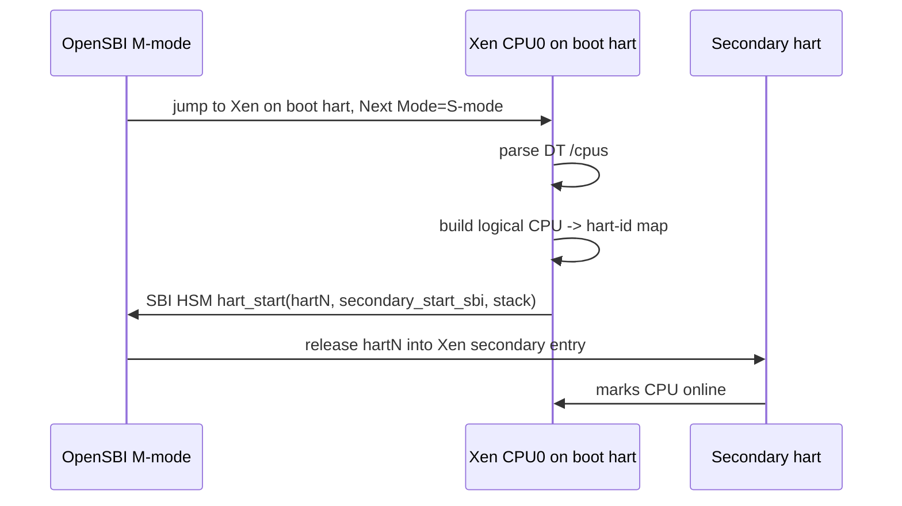
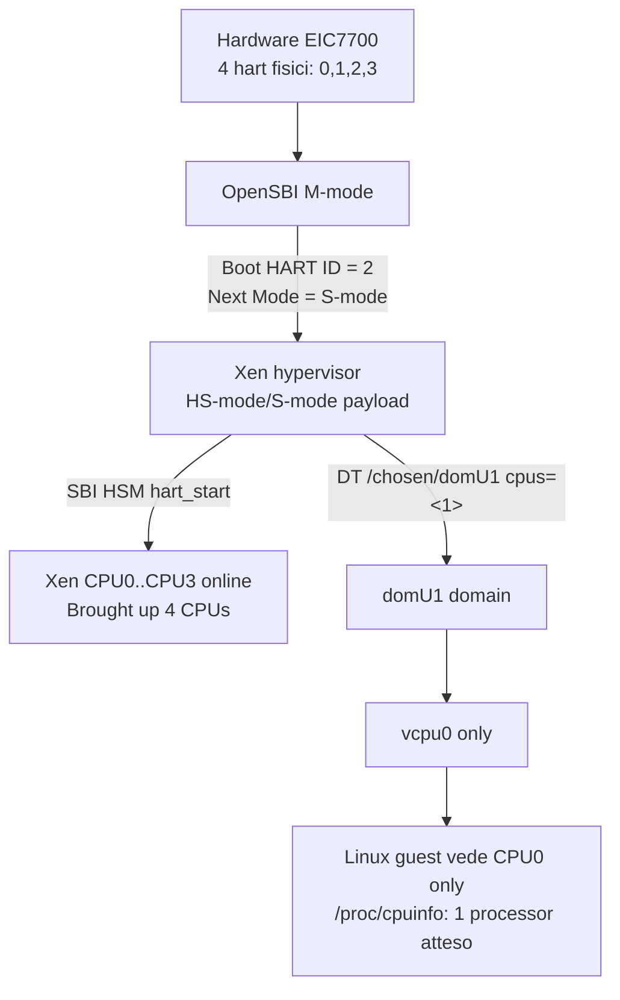

# RISC-V, hart, S-mode e vCPU nel boot Xen Megrez

Questa nota spiega, con riferimento al payload Xen di questo repository, quanti core vede Xen, quanti ne vede il domU, dove vengono assegnati e come funziona il rilascio dei core.

## Lessico minimo

### Hart

In RISC-V un **hart** e' l'unita' hardware che esegue istruzioni. Per ragionare sulla board, puoi leggerlo come "hardware thread", molto vicino a "core logico".

Sulla Megrez/EIC7700 i log OpenSBI mostrano:

```text
Platform HART Count : 4
Domain0 Boot HART   : 2
Domain0 HARTs       : 0*,1*,2*,3*
Boot HART ID        : 2
```

Quindi la board espone **4 hart hardware**:

```text
hart0, hart1, hart2, hart3
```

### CPU logica

Linux e Xen usano anche il concetto di **logical CPU**:

```text
logical CPU 0, 1, 2, 3
```

Questi numeri non sono necessariamente uguali agli hart-id fisici. C'e' una mappa:

```text
logical CPU -> physical hart-id
```

Nel codice Xen RISC-V questa mappa e':

```c
cpuid_to_hartid_map(cpu)
```

### vCPU

Una **vCPU** e' una CPU virtuale di un dominio Xen. Il domU non riceve direttamente un hart fisico; riceve una o piu' vCPU.

Con la configurazione attuale del repository:

```text
domU1 cpus = 1
```

quindi il domU vede **una sola CPU virtuale**.

## Situazione concreta del repository

### Xen vede 4 core/hart hardware

Evidenza dai log:

```text
Platform HART Count : 4
SMP: Allowing 4 CPUs
Brought up 4 CPUs
```

Quindi Xen, come hypervisor, vede e porta online tutti e 4 gli hart hardware.

OpenSBI mostra:

```text
OpenSBI:
  Platform HART Count : 4
  Domain0 Boot HART   : 2
  Domain0 HARTs       : 0*,1*,2*,3*
  Boot HART ID        : 2
```

Poi Xen mostra:

```text
(XEN) SMP: Allowing 4 CPUs
(XEN) Brought up 4 CPUs
```

Traduzione:

1. OpenSBI parte in M-mode.
2. Il boot hart scelto dalla piattaforma e' `hart2`.
3. OpenSBI lancia Xen come payload supervisor.
4. Xen rilascia gli altri hart con chiamate SBI HSM.
5. Alla fine Xen ha 4 CPU online.

### domU vede 1 core/vCPU

Il payload generato da `scripts/board-xen-smoke.sh` scrive nel DTB di boot:

```text
fdt set /chosen/domU1 cpus <0x1>
```

Nel `stage/xen/board-xen-smoke/boot.cmd` attuale:

```text
fdt set /chosen/domU1 compatible "xen,domain"
fdt set /chosen/domU1 cpus <0x1>
fdt set /chosen/domU1 memory <0x0 0x80000>
fdt set /chosen/domU1 vsbi_uart
```

Quindi Xen riceve questa descrizione:

```dts
/chosen/domU1 {
    compatible = "xen,domain";
    cpus = <0x1>;
    ...
};
```

Nel codice Xen:

```c
if ( !dt_property_read_u32(node, "cpus", &d_cfg.max_vcpus) )
    panic("Missing property 'cpus' for domain %s\n", dt_node_name(node));

d = domain_create(++max_init_domid, &d_cfg, flags);
```

Quindi:

```text
/chosen/domU1/cpus = <1>
        -> d_cfg.max_vcpus = 1
        -> domain_create(... max_vcpus=1 ...)
        -> domU1 ha 1 vCPU
```

Poi, durante la costruzione del dominio:

```c
printk("*** LOADING DOMU cpus=%u memory=%#"PRIx64"KB ***\n",
       d->max_vcpus, mem);

if ( vcpu_create(d, 0) == NULL )
    return -ENOMEM;
```

Con `max_vcpus = 1`, Xen crea solo:

```text
domU1 vcpu0
```

Non crea `vcpu1`, `vcpu2`, ecc.

## Dove vengono assegnati i core al domU

La proprieta':

```text
cpus <0x1>
```

non significa "assegna hart1" o "usa CPU fisica 1".

Significa invece:

```text
crea 1 vCPU per questo dominio
```

Poi lo scheduler Xen decide su quale CPU fisica eseguirla.

Nel boot Xen corrente hai:

```text
sched=null
```

in:

```text
fdt set /chosen xen,xen-bootargs "bootscrub=0 com1=poll sched=null sync_console"
```

Quindi Xen usa lo scheduler `null`, molto semplice, adatto a sistemi statici/dom0less. Concettualmente resta vero:

```text
domU vCPU != hart fisico
```

E' meglio pensare cosi':

```text
hart fisici:  hart0 hart1 hart2 hart3
Xen CPUs:     cpu0  cpu1  cpu2  cpu3
domU vCPU:    vcpu0
scheduler:    decide dove gira vcpu0
```

Con un solo domU e `sched=null`, la vCPU tende a essere assegnata in modo stabile, ma non e' la proprieta' `cpus` a dire "usa hart N".

## Come Xen costruisce il DTB visto dal domU

Xen non passa al domU il DTB completo della board. Gli costruisce un DTB guest.

Nel codice Xen viene chiamato:

```c
make_cpus_node(d, kinfo->fdt);
```

e dentro:

```c
for ( cpu = 0; cpu < d->max_vcpus; cpu++ )
{
    snprintf(buf, sizeof(buf), "cpu@%u", cpu);
    ...
    fdt_property(fdt, "reg", &reg, sizeof(uint32_t));
    fdt_property_string(fdt, "status", "okay");
    fdt_property(fdt, "compatible", compatible, len_compatible);
    fdt_property(fdt, "mmu-type", mmu, len_mmu);
    fdt_property(fdt, "riscv,isa", isa, len_isa);
}
```

Con `d->max_vcpus = 1`, il DTB del domU contiene solo:

```dts
/cpus {
    cpu@0 {
        reg = <0>;
        status = "okay";
        compatible = "...";
        riscv,isa = "...";
    };
};
```

Quindi Linux nel domU vede:

```text
CPU0 only
```

Se si impostasse:

```sh
DOMU_CPUS=0x2 make board-xen-smoke ...
```

Xen genererebbe due CPU virtuali nel DTB guest:

```dts
cpu@0
cpu@1
```

Il domU proverebbe quindi a fare SMP. Questo va verificato con un bead dedicato, perche' il path VSBI/SMP guest potrebbe avere limiti nel fork attuale.

## Release dei core: lato Xen

### 1. OpenSBI parte in M-mode

All'accensione, il firmware OpenSBI gira in **M-mode**, cioe' Machine mode: il livello piu' privilegiato RISC-V.

OpenSBI vede i 4 hart hardware:

```text
Platform HART Count : 4
```

Sceglie un boot hart:

```text
Boot HART ID : 2
```

e prepara il payload successivo:

```text
Domain0 Next Mode : S-mode
```

Nel tuo caso il payload successivo e' Xen:

```text
Domain0 Next Address : ...
Domain0 Next Mode    : S-mode
```

Quindi:

```text
M-mode OpenSBI
    -> S-mode/HS-mode Xen
```

I log OpenSBI dicono genericamente `S-mode`. Con hypervisor extension, Xen usa la parte hypervisor del supervisor mode, cioe' **HS-mode**. Il punto pratico e': Xen e' il primo software supervisor dopo OpenSBI.

### 2. Xen parte sul boot hart

Il primo hart che entra in Xen e' quello indicato da OpenSBI:

```text
Boot HART ID : 2
```

Xen lo tratta come la sua CPU logica iniziale. Quindi, nel boot osservato:

```text
Xen logical CPU0 -> physical hart2
```

Poi Xen scansiona `/cpus` nel DTB hardware.

Nel codice:

```c
void __init smp_init_cpus(void)
{
    ...
    dt_for_each_child_node( cpus, cpu )
    {
        ...
        rc = riscv_of_processor_hartid(cpu, &hart);
        ...
        if ( hart == cpuid_to_hartid_map(0) )
        {
            found_boot_cpu = 1;
            continue;
        }

        cpuid_to_hartid_map(cpuid) = hart;
        cpuid++;
    }
}
```

Quindi Xen costruisce una mappa:

```text
Xen logical CPU0 -> boot hart, qui hart2
Xen logical CPU1 -> un altro hart trovato nel DT
Xen logical CPU2 -> un altro hart trovato nel DT
Xen logical CPU3 -> un altro hart trovato nel DT
```

La numerazione logica Xen non e' per forza uguale agli hart fisici.

### 3. Xen rilascia gli altri hart via SBI HSM

Nel setup Xen:

```c
smp_prepare_cpus();

for_each_present_cpu ( i )
{
    if ( (num_online_cpus() < nr_cpu_ids) && !cpu_online(i) )
    {
        int ret = cpu_up(i);
        ...
    }
}
```

`cpu_up(i)` arriva a:

```c
int __cpu_up(unsigned int cpu)
{
    unsigned long boot_addr = LINK_TO_LOAD(secondary_start_sbi);
    unsigned long hartid = cpuid_to_hartid_map(cpu);
    unsigned long hsm_data = LINK_TO_LOAD(&cpu_stack[STACK_SIZE * cpu]);

    ret = sbi_hsm_hart_start(hartid, boot_addr, hsm_data);
    ...
}
```

Cioe' Xen dice a OpenSBI:

```text
Per favore avvia hart fisico H
facendolo entrare all'indirizzo secondary_start_sbi
con questo stack
```

La chiamata concreta e' SBI HSM:

```c
sbi_hsm_hart_start(hartid, boot_addr, hsm_data);
```

HSM significa **Hart State Management**.

Flusso:



Alla fine Xen stampa:

```text
Brought up 4 CPUs
```

## Release dei core: lato domU

Con la configurazione attuale **non c'e' release di core secondari nel domU**, perche' il domU ha una sola vCPU.

Il domU parte cosi':

```text
domU vcpu0
```

Linux nel domU entra su CPU0/vhart0. Non ha CPU1 da rilasciare.

Se invece configurassi `DOMU_CPUS=0x2`, succederebbe questo:

1. Xen crea `vcpu0` e `vcpu1`.
2. Xen genera nel DTB guest `cpu@0` e `cpu@1`.
3. Linux guest parte su CPU0.
4. Linux guest vede CPU1 nel DTB.
5. Linux guest usa SBI HSM per avviare il secondo hart.
6. Quella SBI non va a OpenSBI reale: viene intercettata da Xen.
7. Xen emula SBI tramite `vsbi`.

Il codice Xen che emula HSM per il guest e':

```c
static int vsbi_ext_hsm(struct vcpu *vcpu, struct cpu_user_regs *regs)
{
    ...
    case SBI_EXT_HSM_HART_START:
        for ( int i = 0; i < d->max_vcpus; i++ )
        {
            if ( d->vcpu[i]->vcpu_id == regs->a0 )
            {
                rvcpu = d->vcpu[i];
                break;
            }
        }

        ...
        guest_regs(rvcpu)->a0 = rvcpu->vcpu_id;
        guest_regs(rvcpu)->a1 = regs->a2;
        guest_regs(rvcpu)->sepc = regs->a1;
        vcpu_kick(rvcpu);
```

Traduzione:

```text
Linux guest: "SBI, avvia hart 1 all'indirizzo X"
        -> trap/virtualizzazione
Xen: "hart 1 nel guest = vcpu1"
        -> Xen prepara i registri della vcpu1:
             a0 = vcpu_id
             a1 = opaque/dati boot
             sepc = entry point richiesto dal guest
        -> Xen sveglia vcpu1 con vcpu_kick()
```

Quindi nel guest i "hart" sono virtuali:

```text
guest hart0 == domU vcpu0
guest hart1 == domU vcpu1
```

Non sono direttamente:

```text
guest hart1 == physical hart1
```

## S-mode, M-mode, HS-mode, VS-mode

### Bare-metal normale

Senza Xen:

```text
M-mode OpenSBI
    -> S-mode Linux
    -> U-mode processi utente
```

Linux parla con OpenSBI usando chiamate SBI, per esempio:

```text
timer
IPI
RFENCE
HSM hart_start
SRST reset
```

### Con Xen

Con Xen:

```text
M-mode OpenSBI
    -> HS-mode Xen
    -> VS-mode domU Linux
    -> U-mode processi nel domU
```

I log OpenSBI dicono:

```text
Next Mode : S-mode
```

perche' dal punto di vista OpenSBI il payload successivo e' un supervisor payload. Ma Xen usa le estensioni hypervisor: quindi e' meglio pensarlo come **HS-mode**.

Il domU Linux pensa di essere in S-mode, ma in realta' e' in **VS-mode**, cioe' virtual supervisor mode.

Questa differenza spiega messaggi Xen come:

```text
unhandled guest store
guest-page fault
stage-2
```

Perche':

1. il guest fa accessi come se fosse supervisor;
2. Xen controlla una seconda traduzione di memoria, stage-2;
3. se il guest prova ad accedere a GPA non mappata, trap in Xen.

## Mappa mentale completa



## Risposte dirette

### Quanti core vede domU?

Con il payload attuale:

```text
1
```

Perche':

```text
/chosen/domU1/cpus = <0x1>
```

Il domU riceve **1 vCPU**.

Comandi attesi nel domU:

```sh
nproc
cat /proc/cpuinfo
ls /sys/devices/system/cpu/
```

Output atteso:

```text
nproc -> 1
cpu0 only
```

### Dove vengono assegnati i core del domU?

Nel boot script U-Boot generato:

```text
stage/xen/board-xen-smoke/boot.cmd
```

riga rilevante:

```text
fdt set /chosen/domU1 cpus <0x1>
```

Questa riga viene generata da:

```text
scripts/board-xen-smoke.sh
```

con default:

```sh
domu_cpus=${DOMU_CPUS:-0x1}
```

e poi:

```sh
fdt set /chosen/${domain} cpus <${domu_cpus}>
```

Quindi puoi cambiare il numero di vCPU con:

```sh
DOMU_CPUS=0x2 make board-xen-smoke ...
```

ma questa configurazione va verificata separatamente.

### Come funziona la release dei core del domU?

Con `cpus=<1>`:

```text
non c'e' release di core secondari nel domU
```

Parte solo `vcpu0`.

Se `cpus > 1`:

```text
Linux guest chiama SBI HSM HART_START
Xen intercetta via vsbi
Xen traduce hart virtuale N -> vcpuN
Xen prepara sepc/a0/a1 della vcpuN
Xen fa vcpu_kick()
```

### Quanti core vede Xen?

Xen vede:

```text
4
```

Evidenza:

```text
OpenSBI: Platform HART Count : 4
Xen:    SMP: Allowing 4 CPUs
Xen:    Brought up 4 CPUs
```

### Dove vengono assegnati i core Xen?

Xen li prende dal DTB hardware della board, nodo:

```text
/cpus
```

Il log mostra che il DTB contiene:

```text
cpu@0
cpu@1
cpu@2
cpu@3
```

e componenti per hart:

```text
bus-error-unit@hart0
bus-error-unit@hart1
bus-error-unit@hart2
bus-error-unit@hart3
```

OpenSBI dice:

```text
Domain0 HARTs : 0*,1*,2*,3*
```

cioe' il dominio root OpenSBI, quello che lancia Xen, ha accesso a tutti e 4 gli hart.

### Come funziona la release dei core Xen?

1. OpenSBI avvia Xen su un solo hart, nel boot osservato `hart2`.
2. Xen parse-a `/cpus`.
3. Xen costruisce la mappa logical CPU -> hart-id.
4. Xen chiama SBI HSM `hart_start` per ogni hart secondario.
5. OpenSBI rilascia ogni hart secondario all'entry point Xen `secondary_start_sbi`.
6. Xen attende che la CPU diventi online.
7. Xen stampa:

```text
Brought up 4 CPUs
```

## Differenza chiave da ricordare

Per Xen:

```text
hart fisici reali: 0,1,2,3
Xen li porta online via OpenSBI HSM
```

Per domU:

```text
hart virtuali = vCPU
cpus=<N> decide quanti ne vede
Xen emula SBI HSM per rilasciarli
```

Quindi:

```text
Xen vede hardware.
domU vede una macchina virtuale costruita da Xen.
```

Nel setup attuale:

```text
Hardware: 4 hart
OpenSBI: 4 hart nel root domain
Xen:     4 CPU online
domU1:   1 vCPU / 1 virtual hart
```
