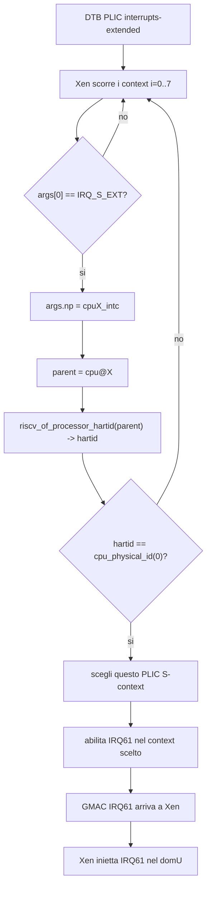

# Xen RISC-V: perche' il PLIC S-context era sbagliato

Questa nota spiega il problema che ha richiesto l'intervento nel codice Xen sul PLIC, cosa significa "selezionare il PLIC S-context il cui parent CPU node corrisponde a `cpu_physical_id(0)`", e cosa fa effettivamente Xen.

## Riassunto

Il problema non era il numero di core in se'. Il problema era **quale context PLIC Xen usava per ricevere gli interrupt esterni**.

Sulla Megrez/EIC7700 OpenSBI ha avviato Xen su:

```text
Boot HART ID : 2
```

Quindi la CPU logica 0 di Xen gira inizialmente su:

```text
hart2
```

Il PLIC, pero', ha context separati per hart e per privilege target. Per ricevere interrupt esterni in S-mode/HS-mode su `hart2`, Xen deve usare il context:

```text
hart2 S-mode context
```

Nel DTB della board questo corrisponde a:

```text
context 5
```

Prima del fix Xen sceglieva il primo S-context disponibile, che sulla board corrispondeva a:

```text
context 1 = hart0 S-mode
```

Quindi Xen stava abilitando/claimando interrupt nella cassetta PLIC sbagliata.

Effetto pratico:

```text
GMAC genera IRQ61
    -> il PLIC lo consegna al context sbagliato
    -> Xen non lo claim-a dal context dove sta girando
    -> il vPLIC non inietta correttamente IRQ61 nel domU
    -> eth0 non riceve interrupt in modo corretto
```

Dopo il fix:

```text
GMAC genera IRQ61
    -> PLIC context 5, associato a hart2 S-mode
    -> Xen claim-a IRQ61
    -> Xen inietta IRQ61 nel domU
    -> ping funziona
```

## Il DTB: dove sono descritti i context PLIC

Nel DTS EIC7700 il PLIC e' descritto cosi':

```dts
plic0: interrupt-controller@c000000 {
    #interrupt-cells = <1>;
    compatible = "sifive,plic-1.0.0";
    interrupt-controller;
    interrupts-extended = <
        &cpu0_intc 0xffffffff &cpu0_intc 9
        &cpu1_intc 0xffffffff &cpu1_intc 9
        &cpu2_intc 0xffffffff &cpu2_intc 9
        &cpu3_intc 0xffffffff &cpu3_intc 9>;
    reg = <0x0 0xc000000 0x0 0x4000000>;
    reg-names = "control";
    riscv,max-priority = <7>;
    riscv,ndev = <520>;
    numa-node-id = <0>;
};
```

Fonte:

```text
stage/src/rockos-kernel/arch/riscv/boot/dts/eswin/eswin-win2030-arch.dtsi
```

La proprieta' importante e':

```dts
interrupts-extended = <
    &cpu0_intc 0xffffffff &cpu0_intc 9
    &cpu1_intc 0xffffffff &cpu1_intc 9
    &cpu2_intc 0xffffffff &cpu2_intc 9
    &cpu3_intc 0xffffffff &cpu3_intc 9>;
```

Interpretazione operativa:

```text
context 0 -> cpu0_intc, irq 0xffffffff
context 1 -> cpu0_intc, irq 9
context 2 -> cpu1_intc, irq 0xffffffff
context 3 -> cpu1_intc, irq 9
context 4 -> cpu2_intc, irq 0xffffffff
context 5 -> cpu2_intc, irq 9
context 6 -> cpu3_intc, irq 0xffffffff
context 7 -> cpu3_intc, irq 9
```

`irq 9` e':

```text
IRQ_S_EXT
```

cioe' **supervisor external interrupt**.

Quindi gli S-context usabili da Xen sono:

```text
context 1 -> hart0 S-mode
context 3 -> hart1 S-mode
context 5 -> hart2 S-mode
context 7 -> hart3 S-mode
```

Siccome Xen parte su `hart2`, deve usare:

```text
context 5
```

## Cosa significa `args.np->parent`

Nel DTB ogni CPU ha un interrupt-controller locale figlio.

Semplificato:

```dts
cpu_2: cpu@2 {
    device_type = "cpu";
    reg = <2>;
    compatible = "eswin,eic770x", "riscv";

    cpu2_intc: interrupt-controller {
        compatible = "riscv,cpu-intc";
        interrupt-controller;
        #interrupt-cells = <1>;
    };
};
```

Quando il PLIC dice:

```dts
&cpu2_intc 9
```

sta dicendo:

```text
questo PLIC context consegna IRQ_S_EXT al local interrupt controller di cpu@2
```

Nel codice Xen:

```c
args.np
```

punta al nodo phandle risolto, per esempio:

```text
cpu2_intc
```

mentre:

```c
args.np->parent
```

punta al nodo CPU padre:

```text
cpu@2
```

Da `cpu@2`, Xen puo' leggere l'hart-id fisico:

```text
reg = <2>
```

quindi:

```text
hartid = 2
```

## Il codice Xen che sceglie il context

Il fix e' nella funzione:

```c
static unsigned int __init plic_find_s_context(const struct dt_device_node *node)
```

File:

```text
stage/src/xen/xen/arch/riscv/plic.c
```

Codice rilevante:

```c
static unsigned int __init plic_find_s_context(const struct dt_device_node *node)
{
    struct dt_phandle_args args;
    unsigned int first_s_context = ~0U;
    unsigned long hartid;
    int count;

    count = dt_count_phandle_with_args(node, "interrupts-extended",
                                       "#interrupt-cells");
    for ( int i = 0; i < count; i++ )
    {
        if ( dt_parse_phandle_with_args(node, "interrupts-extended",
                                        "#interrupt-cells", i, &args) )
            continue;

        if ( args.args_count < 1 || args.args[0] != IRQ_S_EXT )
            continue;

        if ( first_s_context == ~0U )
            first_s_context = i;

        if ( args.np && args.np->parent &&
             !riscv_of_processor_hartid(args.np->parent, &hartid) &&
             hartid == cpu_physical_id(0) )
            return i;
    }

    if ( first_s_context != ~0U )
    {
        printk(XENLOG_WARNING
               "PLIC: no S-context for boot hart%ld, falling back to context%u\n",
               cpu_physical_id(0), first_s_context);
        return first_s_context;
    }

    panic("PLIC: no S-context found\n");
}
```

## Spiegazione riga per riga

### Conta i context descritti dal DTB

```c
count = dt_count_phandle_with_args(node, "interrupts-extended",
                                   "#interrupt-cells");
```

Nel nostro DTB, `count` vale 8:

```text
0: &cpu0_intc 0xffffffff
1: &cpu0_intc 9
2: &cpu1_intc 0xffffffff
3: &cpu1_intc 9
4: &cpu2_intc 0xffffffff
5: &cpu2_intc 9
6: &cpu3_intc 0xffffffff
7: &cpu3_intc 9
```

### Scorre ogni context

```c
for ( int i = 0; i < count; i++ )
```

`i` e' l'indice del context PLIC.

### Risolve il phandle

```c
if ( dt_parse_phandle_with_args(node, "interrupts-extended",
                                "#interrupt-cells", i, &args) )
    continue;
```

Per esempio, quando `i = 5`:

```text
args.np      = cpu2_intc
args.args[0] = 9
```

### Tiene solo gli S-context

```c
if ( args.args_count < 1 || args.args[0] != IRQ_S_EXT )
    continue;
```

Scarta i context non S-mode. Nel nostro caso scarta quelli con:

```text
0xffffffff
```

e tiene quelli con:

```text
9
```

cioe':

```text
context 1, 3, 5, 7
```

### Salva un fallback

```c
if ( first_s_context == ~0U )
    first_s_context = i;
```

Il primo S-context e':

```text
context 1 = hart0 S-mode
```

Serve solo come fallback se non si trova il context del boot hart.

### Trova il context del boot hart Xen

```c
if ( args.np && args.np->parent &&
     !riscv_of_processor_hartid(args.np->parent, &hartid) &&
     hartid == cpu_physical_id(0) )
    return i;
```

Questa e' la parte essenziale.

Per `i = 5`:

```text
args.np         = cpu2_intc
args.np->parent = cpu@2
riscv_of_processor_hartid(cpu@2, &hartid) -> hartid = 2
cpu_physical_id(0) -> 2
```

Quindi:

```text
hartid == cpu_physical_id(0)
2 == 2
match
```

Xen ritorna:

```text
i = 5
```

Quindi sceglie:

```text
PLIC S-context 5
```

## Cosa e' `cpu_physical_id(0)`

`cpu_physical_id(0)` vuol dire:

```text
hart-id fisico associato alla CPU logica 0 di Xen
```

Nel boot osservato:

```text
OpenSBI Boot HART ID = 2
```

quindi:

```text
Xen logical CPU0 -> physical hart2
```

per cui:

```text
cpu_physical_id(0) = 2
```

Questa informazione viene dalla mappa Xen:

```c
cpuid_to_hartid_map(cpu)
```

cioe':

```text
logical CPU -> physical hart-id
```

## Cosa fa effettivamente Xen con il context scelto

Dopo aver scelto il context, Xen lo usa per programmare il PLIC.

Il log corretto mostra:

```text
(XEN) PLIC: 520 sources, max priority 7, S-context 5 at 0x0000000c000000
```

Quindi Xen ha scelto:

```text
plic.context = 5
```

Da quel momento, quando Xen configura o legge il PLIC, usa i registri del context 5.

Il PLIC ha registri globali e registri per-context:

```text
priority[source]                globale
pending[source]                 globale
enable[context][source]         per context
threshold[context]              per context
claim_complete[context]         per context
```

Per l'interrupt del GMAC:

```text
IRQ61
```

Xen deve fare operazioni equivalenti a:

```text
priority[61] = 1
enable[context 5][61] = 1
threshold[context 5] = 0
```

Quando il GMAC genera un interrupt:

```text
GMAC -> IRQ61 -> PLIC
```

il PLIC vede che IRQ61 e' abilitato nel context 5 e segnala un external interrupt a `hart2`.

Xen riceve il trap e fa claim dal context 5:

```text
irq = claim_complete[context 5]
```

Il valore letto e':

```text
irq = 61
```

Poi Xen lo inietta nel domU tramite il vPLIC:

```text
vPLIC DEBUG: injecting IRQ61 into dom1
```

## Prima e dopo il fix

### Prima

```text
OpenSBI boot hart = 2
Xen CPU0 = hart2
PLIC scelto da Xen = primo S-context = context 1 = hart0 S-mode
IRQ61 abilitato su context 1
Xen aspetta interrupt sul path hart2/context 5
mismatch
```

Effetto:

```text
IRQ fisico non claimato correttamente dal path Xen attivo
vPLIC non inietta stabilmente IRQ61 nel domU
eth0 non riceve interrupt in modo corretto
```

### Dopo

```text
OpenSBI boot hart = 2
Xen CPU0 = hart2
Xen cerca il context il cui parent CPU node ha hart-id 2
Xen trova &cpu2_intc 9
Xen sceglie context 5
IRQ61 abilitato su context 5
Xen riceve e claim-a IRQ61
Xen inietta IRQ61 nel domU
```

Effetto osservato nei log:

```text
(XEN) PLIC DEBUG: claimed physical IRQ61
(XEN) vPLIC DEBUG: injecting IRQ61 into dom1
```

e il ping statico nel domU funziona:

```text
64 bytes from 192.168.188.132: seq=0 ...
64 bytes from 192.168.188.132: seq=1 ...
64 bytes from 192.168.188.132: seq=2 ...
3 packets transmitted, 3 packets received, 0% packet loss
```

## Diagramma del match



## Analogia

Il PLIC ha cassette postali separate:

```text
hart0 S-mode -> context 1
hart1 S-mode -> context 3
hart2 S-mode -> context 5
hart3 S-mode -> context 7
```

Xen abita inizialmente qui:

```text
hart2
```

Prima guardava la cassetta sbagliata:

```text
context 1 / hart0 S-mode
```

Dopo il fix guarda la cassetta giusta:

```text
context 5 / hart2 S-mode
```

Per questo ora vede `IRQ61` e puo' consegnarlo al domU.

## Frase chiave

"Selezionare il PLIC S-context il cui parent CPU node corrisponde a `cpu_physical_id(0)`" significa:

```text
Guardare nella descrizione hardware del PLIC,
trovare quale context S-mode consegna interrupt al CPU node del boot hart Xen,
e usare quello per enable/claim/complete degli interrupt esterni.
```

Nel nostro caso concreto:

```text
cpu_physical_id(0) = hart2
hart2 S-context = context 5
Xen deve usare context 5
```

Non:

```text
context 1 = hart0 S-mode
```

## Commit Xen associato

Il commit che contiene il fix e':

```text
dd76769acd fix(riscv): target PLIC boot hart context
```

File modificati:

```text
xen/arch/riscv/plic.c
xen/arch/riscv/traps.c
```
